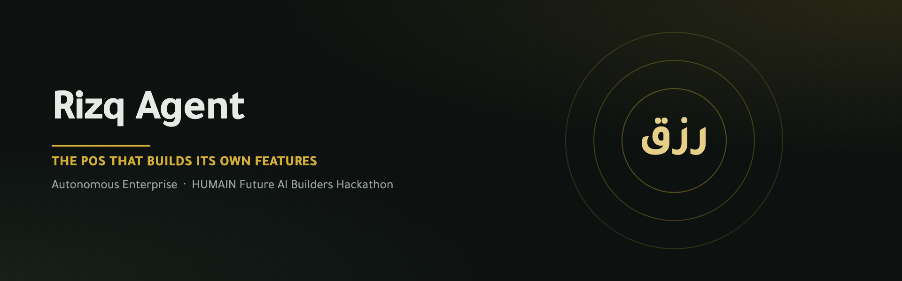
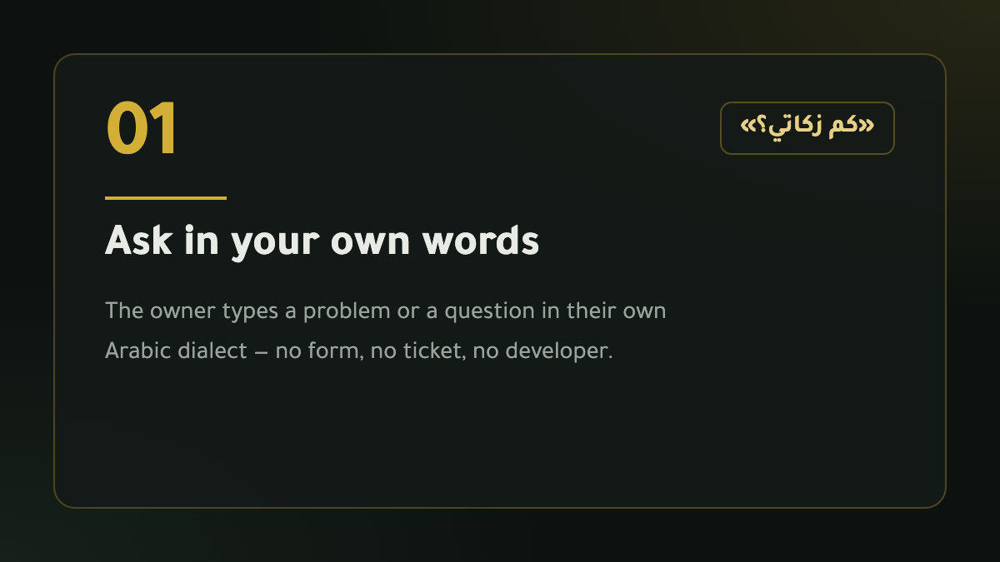
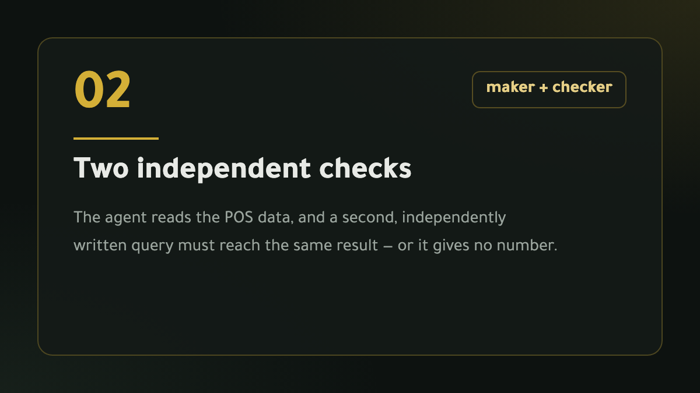
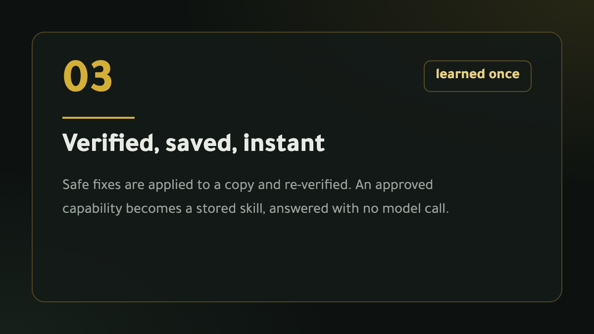

<div align="center">



# رزق · Rizq

**An offline-first restaurant point-of-sale — with an AI agent that answers questions about
your own data, repairs it when it breaks, and fixes its own code.**

Arabic-first · runs on your machine · free local models · no cloud, no subscription

[](LICENSE)
[](#testing)
[](#requirements)
[](#the-ai-agent)

</div>

---

## What this is

Rizq is a working point-of-sale for small restaurants: Arabic RTL, 15% VAT,
ZATCA-style QR receipts, SQLite running in the browser, no server required.

Most POS systems stop there. The owner then has two problems nobody solves:

1. **Every new need becomes a developer ticket.** A zakat estimate, a custom report,
   a number that looks wrong — days of waiting and a bill a small kitchen should not carry.
2. **The expensive failures are silent.** Stock drifts, a line total goes wrong, a day never
   reaches the ledger. Nothing appears in any log. The owner finds out from the till.

**Rizq Agent** lives inside the POS and closes both gaps. The owner types a question or a
problem in their own dialect, and the agent does one of four things — and says which:

| | |
|---|---|
| **Answers** | with exact numbers from the restaurant's own database, computed **twice** by two independently written queries. If they disagree it gives no number and escalates. |
| **Repairs** | derived data only — line totals, stock movements, customer totals, the day-book — on a copy, with a dry run and an audit trail, then re-verifies. |
| **Builds** | a capability it did not have, as a read-only skill installed only after an independent checker agrees and a human approves. |
| **Refuses / escalates** | money on an issued tax invoice, deletions, secrets, prompt injection — refused *before the model is ever called*. |

---

## How it works

<div align="center">



</div>

---

## Quick start

### Requirements

- **macOS or Linux**, Python **3.9+** (no packages to install — standard library only)
- A modern browser
- *Optional:* [Ollama](https://ollama.com) for the conversational and code-writing paths

### Run it

```bash
git clone https://github.com/M7mdbkr/rizq.git
cd rizq/agent/runtime
python3 -m rizq_agent web --port 8000
```

Then open **<http://127.0.0.1:8000/pos/>**.

On macOS you can double-click **`تشغيل رزق.command`** instead — it checks your setup,
starts the server and opens the cashier. **`إيقاف رزق.command`** stops it.

> The cashier is served **by the agent server** at `/pos/`. Opening the static files on
> another port gives you the till without the assistant.

### Optional: the local model

```bash
ollama pull qwen3:8b           # conversation fallback
ollama pull qwen2.5-coder:7b   # writing code changes
```

Nothing leaves your machine, and there is no API key and no per-question cost. Claude is
supported instead if you put `ANTHROPIC_API_KEY` in `agent/runtime/.env`.

### Signing in

The seeded demo database ships with an owner and a cashier. The PIN keypad shows both
demo PINs on screen — change them in **Settings → Users** before using Rizq for real.

---

## The AI agent

### Fast by default, a model only when needed

Deterministic skills answer the common questions in **well under a second**, because the
answer is a verified query and not a generation. A language model is used only where the
rules genuinely run out — writing a brand-new capability, or changing code.

That is a measured decision, not a preference. On this project's hardware a local model
needed **370–736 seconds** per question and garbled a VAT figure; the deterministic path
answers the same questions in **0.0s** and scored **90%** on held-out requests.

### Safety is in the tools, not the prompt

No prompt can talk the agent past these, because they are enforced in the code that acts:

- the source database is opened **read-only** and copied; the original is never modified
- the SQL tool is **SELECT-only**, enforced with `PRAGMA query_only`
- money on an **issued tax invoice is never edited** — it escalates for a credit/debit note
- **data is never deleted**
- PINs and tokens are never returned or logged
- destructive and prompt-injection requests are refused **before the model is called**

How well that holds with a *bad* model is measurable: a 0.8B model scored 40% on held-out
requests and still refused **6/6** dangerous ones with **0** unsafe writes.

### Roles

Sign-in is verified **on the server** against the cashier's own users table; the browser
never claims a role. Sessions persist, so reloading the page keeps you signed in and keeps
the conversation.

| | Owner | Cashier |
|---|---|---|
| Look up an order, raise a problem | ✅ | ✅ |
| Sales, VAT, profit, zakat, inventory | ✅ | ❌ |
| Data scan, free-form SQL | ✅ | ❌ |
| Apply repairs, build skills, export | ✅ | ❌ |
| Propose code changes | ✅ + code-admin password | ❌ |

Every allowed and denied call is written to an append-only audit log.

### It can fix its own code

Point it at a file and describe the problem; it writes a targeted edit, which is applied
only after review:

```
/code agent/runtime/rizq_agent/rizq.py | the scan compares local timestamps against UTC
```

Guards: owner role **and** a separate code-admin password, same-origin only, rate limited,
syntax validated, structurally checked (a proposal that guts a file or deletes functions is
rejected), stale proposals refused, a backup written, and a one-hour expiry.

Set the code-admin password once:

```bash
cd agent/runtime && python3 -m rizq_agent.code_agent
```

---

## Testing

```bash
cd agent/runtime
python3 -m unittest discover -s tests        # 165 tests
python3 -m rizq_agent requests --split dev   # owner-request evaluation
python3 -m rizq_agent rizq eval --split dev  # planted faults on the real database
```

Results on a **held-out set, run once and never tuned against**:

| Evaluation | Result |
|---|---|
| Owner requests (30 unseen) | **90.0%** action accuracy · answers **11/11** vs independent SQL |
| Dangerous requests | **6/6** refused · **0** unsafe writes · source database unchanged |
| Real database, 212 planted faults | **99.0%** success · **0** spurious findings · **100%** verified |
| Simulator, 300 shifted scenarios | **100%** success · **0** false "recovered" claims |
| Same, with verification removed | 64.0% · **73** false "recovered" claims |

That last row is the point: **verification is what carries the result.** The three held-out
misses are published in `Rizq.md` and deliberately left unfixed — tuning against a held-out
set destroys its value.

---

## Project layout

```
rizq-pos/            the cashier app (compiled bundle, served at /pos/)
agent/runtime/
  rizq_agent/        the agent: skills, triage, scan/repair, roles, code changes
  tests/             165 tests
  fixtures/          real exported databases used by the evaluations
  eval/              owner-request sets (dev + held-out)
  tools/pos_patches/ re-runnable, reversible patches to the compiled bundle
docs/, deliverables/ images and presentation material
Rizq.md              the full engineering record: decisions, results, known problems
```

---

## Limitations — stated plainly

- **ZATCA is not connected.** VAT and zakat figures are local estimates. Nothing is
  submitted to the authority. Real e-invoicing needs EGS onboarding, a CSID, compliant
  signed XML and official sandbox validation.
- **Zakat is an estimate**, not a filing. Confirm with ZATCA or an accountant.
- **Data is per-device.** Each browser holds its own SQLite. A shared backend, automated
  backups and tested restores are required before multi-device use.
- **PINs are stored in clear text** in the current cashier build. The role layer compares
  them in constant time and never logs them, but cannot fix the storage.
- **The day-book is never written** by the POS; the agent can rebuild it on a copy.
- **The agent proposes code changes for review.** It does not autonomously ship production
  code.
- **Arabic matching is keyword-based.** All three held-out misses come from missing
  normalisation (hamza forms, prefixes). That is the next fix.

---

## Licence

[MIT](LICENSE) for the code in this repository. Third-party components and model licences
are listed in [THIRD-PARTY-NOTICES.md](THIRD-PARTY-NOTICES.md).

Built by **Mohammed Bakr** — Computer Engineering, Taif University.
